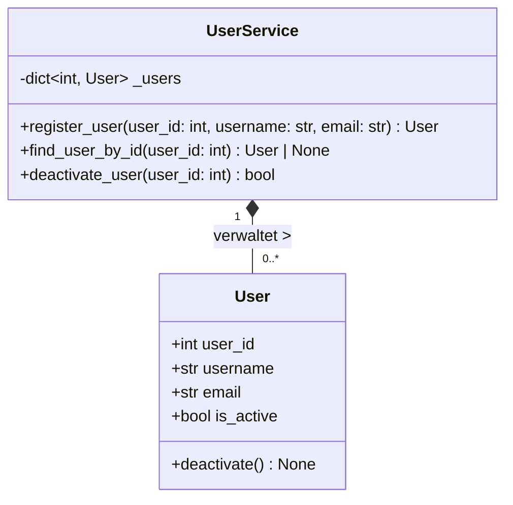
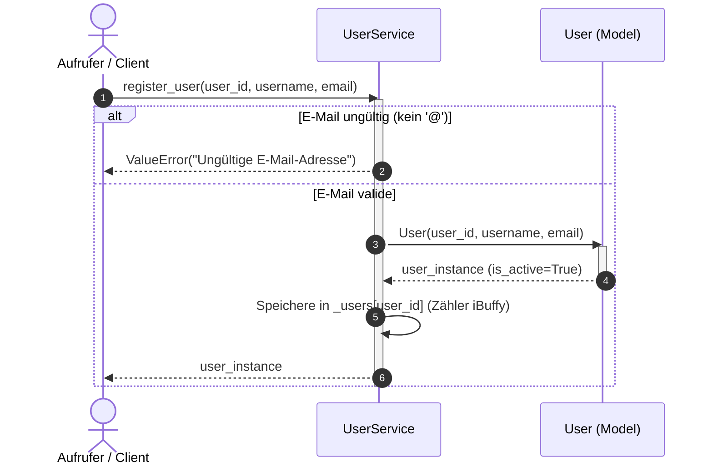
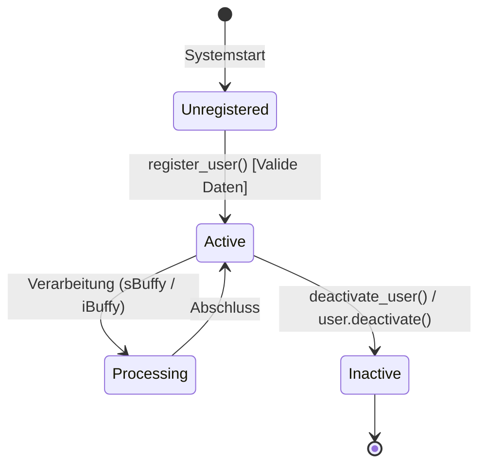
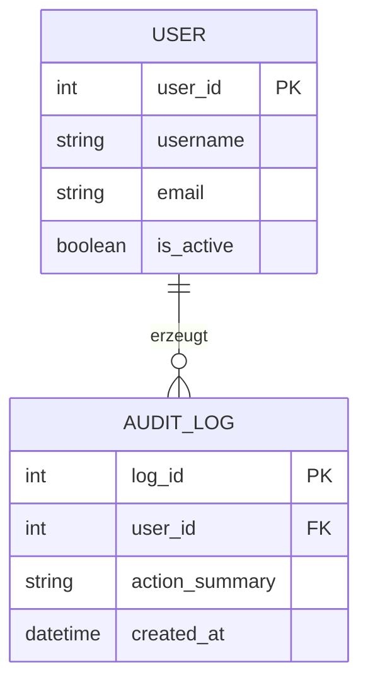

# SKILL: Technische Architektur-Dokumentation & Mermaid-UML (`tech-docs`)

> **Rolle & Einsatzzweck:**
> Dieser Skill standardisiert die Erstellung und Pflege der technischen Entwickler-Dokumentation (`docs/architecture/`, `docs/api/`, `docs/TECHNICAL_DOCS.md`) sowie des chronologischen Projekt-Journals (`docs/JOURNAL.md`) mit reichhaltigen, direkt in Markdown gerenderten Architektur- und UML-Diagrammen.

---

## 1. Ausgabeformat, Struktur & Datenschutz

- **Format:** Reines GitHub-Flavored Markdown (GFM) auf **Deutsch** (Code-Bezeichner, Klassennamen und Methoden bleiben auf **Englisch**).
- **Ablageort:** `docs/TECHNICAL_DOCS.md`, `docs/architecture/`, `docs/api/` sowie `docs/JOURNAL.md`.
- **Pflicht-Inhalte:**
  1. **System- & Schichtenarchitektur:** Überblick über Module, Packages und Verantwortlichkeiten nach dem Single Responsibility Principle (SRP).
  2. **Domänenmodell & Klassendesign:** Beschreibung der Kernklassen, Entitäten, Kapselung und Schnittstellen.
  3. **Datenflüsse & Laufzeitverhalten:** Abläufe wichtiger Geschäftsprozesse, Puffer-Konzepte (`sBuffy` für String-Puffer, `iBuffy` für Integer-/Zähler-Puffer), Zustandsautomaten (State Machines) und Thread-/Async-Architektur.
  4. **API- & Schnittstellen-Spezifikation:** Wichtigste Methoden-Signaturen, Parameter, Rückgabewerte und Fehlerbehandlung (Exceptions).
- **Strikter Datenschutz (Public-Repo-Konformität):**
  - Verwende in Dokumentationen **niemals absolute Dateipfade des Entwickler-Systems** (wie `/home/<username>/...` oder `C:\Users\<username>\...`).
  - Nutze ausschließlich sprechende Komponentenbezeichner (z. B. `UserService`, `OrderRepository`) oder relative Projektpfade (`src/...`, `tests/...`).

---

## 2. Verbindliche Architektur- & UML-Diagramme (Mermaid.js)

Jede technische Dokumentation **muss** die Architektur und Abläufe visuell durch passende `mermaid`-Diagramme veranschaulichen (ohne externe Bild-Abhängigkeiten). Wähle je nach Kontext mindestens **drei** der folgenden Diagrammtypen:

### A) System- & Schichtenarchitektur (`flowchart TD` / `LR`)
Visualisiert den modularen Aufbau, Schichten (Presentation, Service/Domain, Data) und Abhängigkeitsrichtungen:

```mermaid
flowchart TD
    subgraph Presentation["Presentation / CLI / API Layer"]
        Ctrl["Controller / Entrypoint"]
    end

    subgraph Domain["Domain & Service Layer (src/)"]
        Svc["UserService<br/>(Geschäftslogik & Validierung)"]
        Model["User<br/>(OOP-Entität & Kapselung)"]
    end

    subgraph Infra["Infrastructure / Storage"]
        Store[("In-Memory / DB Storage")]
    end

    Ctrl -->|"ruft auf"| Svc
    Svc -->|"instanziiert & mutiert"| Model
    Svc -->|"persistiert / lädt"| Store
```


### B) UML-Klassendiagramm (`classDiagram`)
Zeigt Klassen, Attribute, Methoden-Signaturen, Sichtbarkeiten (`+` public, `-` private) und Beziehungen (Komposition, Aggregation, Abhängigkeit):


### C) Sequenzdiagramm für Kernprozesse (`sequenceDiagram`)
Dokumentiert das zeitliche Zusammenspiel der Objekte inklusive Puffer-Nutzung (`sBuffy` / `iBuffy`) und Fehlerpfaden (`alt` / `else`):


### D) Zustandsdiagramm / State Machine (`stateDiagram-v2`)
Modelliert den Lebenszyklus einer Entität, eines UI-Zustands oder eines Worker-Prozesses:


### E) Datenmodell / Entity-Relationship-Diagramm (`erDiagram`)
Bei Datenbank- oder Persistenz-Bezug zur Darstellung von Tabellen, Schlüsseln (`PK`, `FK`) und Kardinalitäten:


> **Mermaid-Qualitätsregeln:**
> - Setze Knotenbeschriftungen mit Sonderzeichen (Klammern, Schrägstriche, Doppelpunkte) immer in doppelte Anführungszeichen: `Node["Text (Info)"]`.
> - Prüfe vor Abschluss, dass alle `mermaid`-Blöcke syntaktisch valide geschlossen sind.

---

## 3. Pflege des Projekt-Journals (`docs/JOURNAL.md`)

Jeder abgeschlossene Entwicklungsschritt oder Dokumentations-Meilenstein wird chronologisch **ganz oben** in `docs/JOURNAL.md` nach folgendem Schema ergänzt:

```markdown
## [YYYY-MM-DD HH:MM] – [Kurztitel des Meilensteins / Features]
- **Durchgeführte Änderungen:** [Präzise Beschreibung der umgesetzten Komponenten / Dokumentation]
- **Architekturentscheidungen (Warum):** [Begründung für gewählte Muster/Datenstrukturen]
- **Verifikation:** `[Unit-Tests PASSED | Security-Audit PASSED | Docs UPDATED]`
- **Offene Punkte / Nächste Schritte:** [To-Dos für die Folgesitzung]
```

