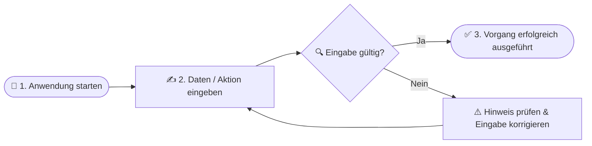
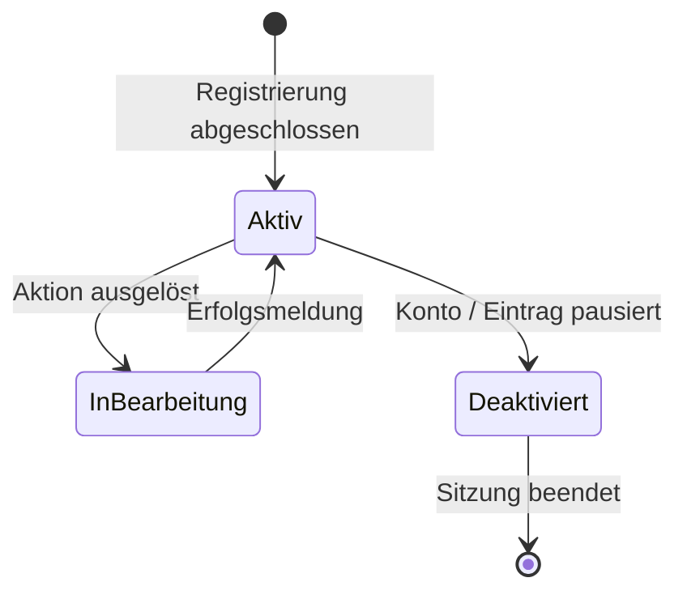
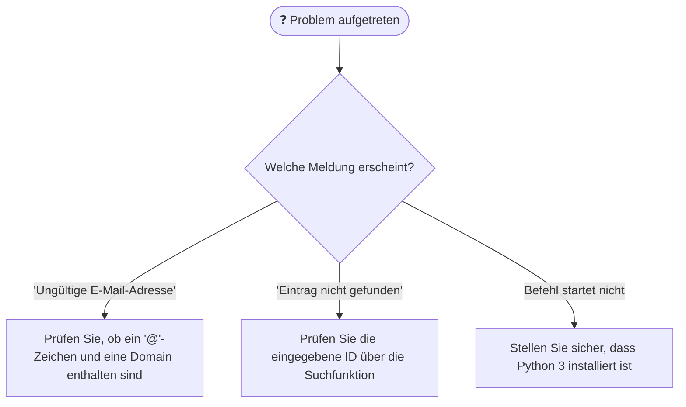

# SKILL: Endbenutzer-Handbuch mit Ablaufdiagrammen & Offline-Build (`user-docs`)

> **Rolle & Einsatzzweck:**
> Dieser Skill automatisiert die Erstellung und Aktualisierung einer benutzerfreundlichen Endanwender-Dokumentation (`docs/USER_GUIDE.md` sowie optional `docs/user_guide.html`) inklusive visueller **Bedien- und Workflow-Diagramme**, UI-Screenshots und strikter Offline-Verfügbarkeit (Zero-CDN).

---

## 1. Inhaltliche Struktur des Benutzerhandbuchs

Ein vollständiges Benutzerhandbuch (`docs/USER_GUIDE.md` / `docs/user_guide.html`) gliedert sich in folgende Abschnitte:
1. **Willkommen & Überblick:** Was macht die Anwendung und für wen ist sie gedacht? (Kurz & allgemeinverständlich ohne Entwickler-Jargon).
2. **Schnellstart (Quickstart in 3 Schritten):** Visueller Einstieg für neue Nutzer vom Start bis zum ersten Erfolgserlebnis.
3. **Visuelle Arbeitsabläufe (Workflows mit Diagrammen):** Schritt-für-Schritt-Anleitungen für alle Hauptfunktionen, unterstützt durch übersichtliche Diagramme.
4. **Bedienelemente, Statusanzeigen & Tastenkürzel (Hotkeys):** Übersichtliche Tabellen aller Befehle, Konfigurationsoptionen und Systemzustände.
5. **Häufige Fragen & Fehlerbehebung (Troubleshooting mit Entscheidungsbaum):** Was tun bei typischen Fehlermeldungen oder unerwartetem Verhalten?

---

## 2. Verbindliche Diagramme für das Benutzerhandbuch

Damit Endanwender Abläufe auf einen Blick erfassen, **muss** das Benutzerhandbuch anschauliche Diagramme enthalten (in Markdown als `mermaid`-Blöcke, in HTML als eingebettetes **Inline-SVG** für 100 % Offline-Fähigkeit ohne externe JS-CDNs):

### A) Schnellstart- & Benutzer-Workflow-Diagramm (User Journey)
Zeigt dem Anwender den typischen Bedienablauf von der Eingabe bis zum Ergebnis:

### B) Visuelle Status- & Bedienübersicht (Was bedeuten die Zustände?)
Erklärt dem Nutzer verständlich, in welchem Zustand sich sein Konto, Datensatz oder die Oberfläche gerade befindet:

### C) Entscheidungsbaum zur Fehlerbehebung (Troubleshooting-Guide)
Hilft dem Benutzer bei Problemen sofort selbstständig zur Lösung zu finden:

---

## 3. Automatisierte Screenshot- & Asset-Generierung (Headless)

Sofern das Projekt eine grafische Benutzeroberfläche (z. B. PySide6 / Qt / Web-UI) besitzt:
1. Führe das Screenshot-Hilfsskript (z. B. `scripts/capture_ui_states.py` mit `QT_QPA_PLATFORM=offscreen`) aus.
2. Validiere, dass alle relevanten UI-Zustände als lokale Bilddateien unter `docs/assets/` abgelegt wurden (z. B. `state_1_active.png`, `state_2_ready.png`, `state_3_expanded.png`).

---

## 4. HTML-Build & Strikte Offline-Fähigkeit (Zero-CDN)

Beim Generieren eines HTML-Handbuchs (`docs/user_guide.html` neben `docs/USER_GUIDE.md`):
- **Zero-CDN / 100 % Offline:** Sämtliche CSS-Stylesheets, Diagramme (als direktes `<svg>...</svg>`) und eventuelle lokale Skripte müssen **inline** oder als rein lokale Projektdateien eingebunden sein.
- **Verbot externer Tracker/Ressourcen:** Es dürfen keinerlei externe `<link>`-, `<script src="https://...">`-, ``- oder Google-Fonts-Aufrufe enthalten sein, die beim Öffnen des Handbuchs eine Internetverbindung aufbauen.

---

## 5. Validierung & Datenschutz-Checkliste (Public-Repo-Konformität)

Prüfe die generierte Benutzerdokumentation vor Abschluss auf folgende Punkte:
- `[ ]` **Anschauliche Diagramme enthalten:** Mindestens ein Workflow-Diagramm (User Journey) und ein Troubleshooting-/Zustandsdiagramm sind vorhanden und fehlerfrei formatiert.
- `[ ]` **Keine externen Verbindungen:** Keine `http://`- oder `https://`-Nachlade-Tags für Styles, Fonts, Diagramm-Renderer oder Skripte.
- `[ ]` **Relative Asset-Pfade:** Alle Bilder und Icons werden über relative Pfade (`assets/...`) referenziert.
- `[ ]` **Datenschutz:** Keinerlei absolute Dateisystempfade des Entwicklers (`/home/<username>/...` oder `C:\Users\<username>\...`) oder lokale Benutzernamen im HTML-/Markdown-Quelltext.
- `[ ]` **Verständlichkeit:** Klare deutsche Schritt-für-Schritt-Erklärung aller Funktionen, Tastenkürzel (Hotkeys) und Optionen für Endanwender.

