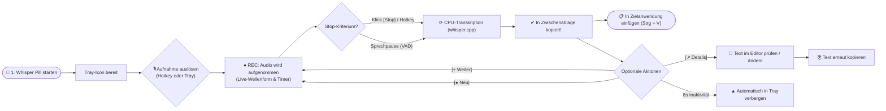
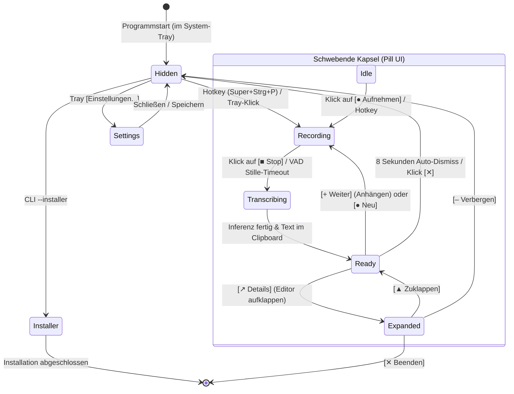
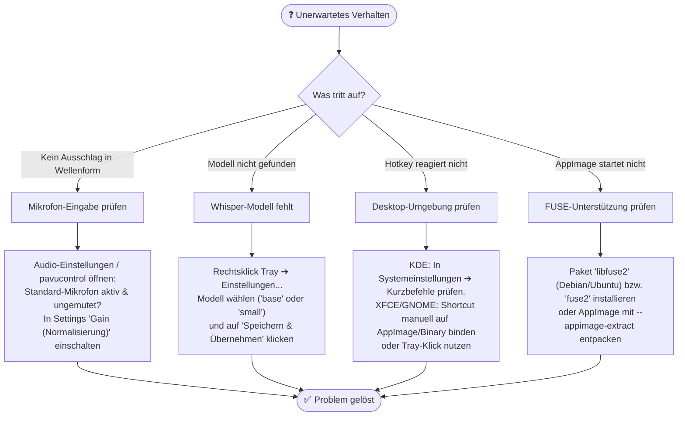
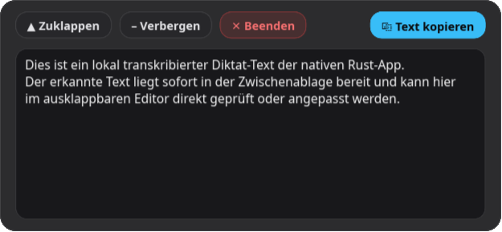
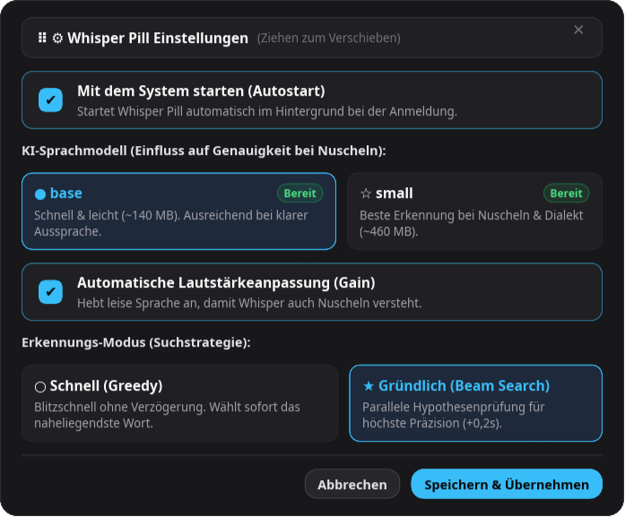
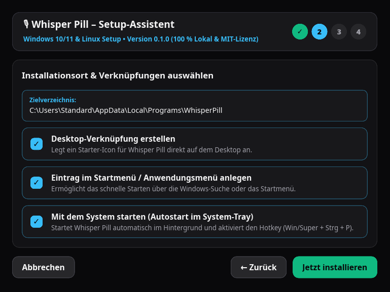

# Whisper Pill – Benutzerhandbuch (Rust-App, Slint-UI & AppImage)

> **Schlankes, minimalistisches, schwebendes Desktop-Diktier-Utility für Linux (KDE Plasma, XFCE, GNOME) und Windows – 100 % lokal, quelloffen und datenschutzfokussiert.**

---

## 1. Willkommen & Überblick

**Whisper Pill** ist eine native Desktop-Anwendung mit moderner Slint-Benutzeroberfläche, die gesprochene Sprache per Tastendruck lokal in präzisen Text inklusive Satzzeichen und Kommas umwandelt. Das fertige Diktat wird sofort in die System-Zwischenablage gelegt und steht überall mit <kbd>Strg</kbd> + <kbd>V</kbd> zum Einfügen bereit.

* **100 % Offline & Maximaler Datenschutz:** Die gesamte Spracherkennung erfolgt lokal auf deiner CPU über `whisper.cpp` (`whisper-rs`). Keine Cloud, kein externes Backend, keine Benutzer-Accounts oder Telemetrie. Audiodaten werden unmittelbar nach der Erkennung im RAM gelöscht.
* **Tray-First & Schwebende Kapsel:** Whisper Pill läuft unaufdringlich im System-Tray (Benachrichtigungsbereich der Taskleiste) und blendet die schwebende Kapsel („Pill“) nur dann ein, wenn du sprichst oder deinen Text bearbeiten möchtest.
* **Maximale Portabilität & Nativer Installer:** Als einzelnes, ca. 13 MB schlankes Linux-AppImage ohne Installation nutzbar oder über den integrierten 4-Schritte Slint-Installationsassistenten fest im System verankerbar.

---

## 2. Schnellstart in 3 Schritten (Quickstart)

```text
┌─────────────────────────────────────────────────────────────────────────────┐
│ 1. Starten              ➔ 2. Sprechen               ➔ 3. Einfügen           │
│ AppImage ausführen         Globales Kürzel drücken     Text liegt sofort im │
│ oder Installer nutzen      oder Kapsel anklicken       Clipboard (Strg + V) │
└─────────────────────────────────────────────────────────────────────────────┘
```

1. **Starten:** Führe `Whisper_Pill-x86_64.AppImage` aus oder starte die Anwendung über das Anwendungsmenü nach der Installation. Das Kapsel-Icon erscheint im System-Tray.
2. **Diktieren:** Drücke die globale Tastenkombination <kbd>Super</kbd> + <kbd>Strg</kbd> + <kbd>P</kbd> (unter KDE automatisch aktiv) oder klicke im Tray-Icon auf **Aufnahme starten**. Sprich deinen Text; eine Live-Wellenform visualisiert deine Stimme.
3. **Einfügen:** Beende die Aufnahme mit erneutem Tastendruck oder klicke auf `[■ Stop]` (oder mache einfach eine Sprechpause, damit die automatische Stille-Erkennung stoppt). Der Text wird transkribiert und liegt sofort mit <kbd>Strg</kbd> + <kbd>V</kbd> zum Einfügen bereit!

---

## 3. Visuelle Arbeitsabläufe (Workflows mit Diagrammen)

### A) Benutzer-Workflow (User Journey)



---

### B) Visuelle Status- und Bedienübersicht (State Machine)



---

### C) Entscheidungsbaum zur Fehlerbehebung (Troubleshooting-Guide)



---

## 4. Die 6 Oberflächen-Zustände der Rust-App

### 4.1 Ruhezustand (`Idle` – `520 × 48 px`)
Wenn die Kapsel eingeblendet ist und auf eine Aufnahme wartet, zeigt sie links den Programmtitel und rechts den Start-Button `[● Aufnehmen]`:


---

### 4.2 Aktive Sprachaufnahme (`Recording` – `520 × 48 px`)
Sobald du sprichst, visualisieren **11 zentrierte Wellenform-Balken** in Echtzeit deinen Mikrofonpegel. Rechts laufen der Timer (`00:04`) und der `[■ Stop]`-Button. Bei einer längeren Sprechpause beendet die integrierte **Voice Activity Detection (VAD)** die Aufnahme auf Wunsch vollautomatisch:


---

### 4.3 Fertig & Kopiert (`Ready` – `520 × 48 px`)
Nach der lokalen Inferenz liegt der Text sofort in deiner Zwischenablage (`✔ In Zwischenablage kopiert!`). Folgende Schnellaktionen stehen bereit:
* Sofort im Zielprogramm <kbd>Strg</kbd> + <kbd>V</kbd> drücken.
* **`[+ Weiter]`:** Startet eine Folgeaufnahme und hängt den neuen Text nahtlos an das bestehende Diktat an.
* **`[● Neu]`:** Verwirft das bisherige Diktat und startet eine frische Aufnahme.
* **`[↗ Details]`:** Klappt den Texteditor zur Prüfung und Korrektur auf.
* **Auto-Dismiss (8 Sekunden):** Ohne weitere Aktion blendet sich die Kapsel nach 8 Sekunden automatisch wieder in den System-Tray aus.


---

### 4.4 Ausgeklappter Text-Editor (`Expanded` – `520 × 240 px`)
Im erweiterten Modus kannst du längere Texte prüfen, frei bearbeiten und mit dem **Mausrad** oder über die **rechte Scrollbar** durch das Transkript navigieren:
* **`[▲ Zuklappen]`:** Kehrt zur kompakten Kapselansicht zurück.
* **`[– Verbergen]`:** Minimiert das Fenster in den System-Tray.
* **`[✕ Beenden]`:** Schließt Whisper Pill vollständig.
* **`[⎘ Text kopieren]`:** Übernimmt deine Textkorrekturen direkt wieder in die System-Zwischenablage.



---

### 4.5 Integrierter Einstellungs-Dialog (`Settings` – `580 × 480 px`)
Über einen Rechtsklick auf das Tray-Icon → **Einstellungen...** öffnet sich das Konfigurationsfenster:



1. **Mit dem System starten (Autostart):** Erstellt automatisch einen XDG-Autostart-Eintrag. Erkennt beim Betrieb als AppImage selbstständig den dauerhaften Pfad (selbstheilend bei Updates).
2. **KI-Sprachmodell (`base` vs. `small`):**
   * **`base` (~140 MB):** Sehr schnelle Transkription bei geringem RAM-Bedarf – ideal für kurze Notizen.
   * **`small` (~460 MB):** Höhere Erkennungsgüte bei schnellem Sprechen, Dialekten oder Fachbegriffen.
   * Fehlt das Modell lokal, lädt Whisper Pill es bei Klick auf **`[Speichern & Übernehmen]`** automatisch im Hintergrund herunter.
3. **Automatische Lautstärkeanpassung (Gain):** Hebt leise Mikrofonaufnahmen dynamisch auf einen optimalen Pegel an (bis max. 5-fache Verstärkung ohne Übersteuern).
4. **Erkennungs-Modus (Suchstrategie):**
   * **Schnell (Greedy):** Sofortige Wortauswahl für minimale Latenz.
   * **Gründlich (Beam Search):** Prüft 5 parallele Hypothesen für optimale Grammatik und Kommasetzung.

---

### 4.6 Nativer 4-Schritte Installations-Assistent (`Installer` – `640 × 480 px`)
Whisper Pill enthält einen eigenständigen, grafischen Installations-Assistenten im edlen Slint-Dark-Design:



* **Schritt 1 (Willkommen & Lizenz):** Kurzübersicht und Bestätigung der freien MIT-Lizenzvereinbarung.
* **Schritt 2 (Zielverzeichnis & Verknüpfungen):** Frei wählbarer Installationspfad, Optionen für Desktop-Icon, Startmenü-Eintrag und automatischen System-Autostart.
* **Schritt 3 (Fortschritt):** Installation der Binärdatei und automatische Erstellung eines Deinstallations-Skripts (`uninstall.sh` bzw. `uninstall.cmd`).
* **Schritt 4 (Fertigstellung):** Zusammenfassung mit Option zum direkten Starten von Whisper Pill.

---

## 5. Desktop-Umgebungen: KDE Plasma, XFCE & Windows

### 5.1 KDE Plasma 5 & 6 (Wayland & X11)
* **Globaler Shortcut (`Super` + `Strg` + `P`):** Beim Start automatisch bei `KGlobalAccel` registriert.
* **Strikte Signal-Isolierung:** Reagiert ausschließlich auf das eigene Signal `/component/whisper_pill`. Externe Shortcuts wie <kbd>F12</kbd> (Yakuake) oder die <kbd>Super</kbd>-Taste lösen niemals fälschlich aus.
* **KWin-Fensterregeln & Z-Order:** Whisper Pill trägt sich automatisch so in KWin ein, dass die Kapsel nicht in der Taskleiste oder im <kbd>Alt</kbd>+<kbd>Tab</kbd>-Umschalter auftaucht und Dropdown-Terminals (Yakuake) nicht behindert werden.
* **System-Tray (StatusNotifierItem):** Das Kapsel-Icon im Benachrichtigungsbereich wechselt während der Transkription live auf eine bernsteinfarbene Wellenform (`ılı`).

### 5.2 XFCE Desktop (X11)
* **System-Tray:** Nutzt das Freedesktop `StatusNotifierItem`-Protokoll (aktivierbar über das XFCE-Panel-Plugin *Benachrichtigungsfläche*).
* **EWMH-Fensterattribute:** Über EWMH-Atome (`_NET_WM_STATE_SKIP_TASKBAR`, `_NET_WM_STATE_SKIP_PAGER`) bleibt die Kapsel rahmenlos und schwebend, ohne die Fensterleiste zu belegen.
* **Audio:** Volle Unterstützung von PipeWire und PulseAudio; Pegel und Mikrofone können über `pavucontrol` ausgesteuert werden.

### 5.3 Windows 10 & 11
* **Start & Tray:** Nativer Windows-Tray-Support mit vollem Kontextmenü.
* **NSIS-Setup & Slint-Wizard:** Wahlweise als klassischer NSIS-Installer (`Whisper_Pill_Setup_x86_64.exe`) mit Registry-Uninstaller oder über den Slint-Installer ausführbar.
* **Autostart:** Trägt sich auf Wunsch in `HKCU\Software\Microsoft\Windows\CurrentVersion\Run` ein.

---

## 6. Tastenkombinationen & Steuerung

| Aktion | Tastenkürzel / Steuerung | Beschreibung |
| :--- | :--- | :--- |
| **Aufnahme starten / stoppen** | <kbd>Super</kbd> + <kbd>Strg</kbd> + <kbd>P</kbd> | Globaler Hotkey oder Klick auf das Tray-Icon / den Start-Button. |
| **Transkript einfügen** | <kbd>Strg</kbd> + <kbd>V</kbd> | Fügt das fertige Diktat an der aktuellen Cursor-Position ein. |
| **Kapsel verschieben** | Linke Maustaste gedrückt halten (Drag & Drop) | Ziehe die Kapsel an deine Wunschposition; die Koordinaten werden dauerhaft gespeichert. |
| **System-Tray-Menü** | Rechtsklick auf Tray-Icon | Schnellzugriff auf *Aufnahme*, *Autostart*, *Einstellungen...*, *Fehlerlog öffnen* und *Beenden*. |
| **Kapsel verbergen** | `[– Verbergen]`, `[✕]` oder 8 s warten | Blendet das Overlay in den Tray aus (Prozess läuft im Hintergrund weiter). |
| **Anwendung beenden** | `[✕ Beenden]` im Editor oder Tray → *Beenden* | Schließt Whisper Pill vollständig. |

---

## 7. Konfiguration, Speicherorte & Fehlerbehebung

### Wichtige Speicherorte im System
* **Konfiguration:** `~/.config/whisper_pill/config.json` (bzw. `%APPDATA%\whisper_pill\config.json`).
* **KI-Modelle:** `~/.cache/whisper_pill/` (bzw. `%LOCALAPPDATA%\whisper_pill\`).
* **Fehler-Log:** `~/.local/share/whisper_pill/whisper_pill_error.log`.
* **Autostart-Datei:** `~/.config/autostart/whisper-pill.desktop`.

### Häufige Fragen & Antworten
1. **Was tun bei der Meldung „Whisper-Modell nicht gefunden“?**
   Öffne über Rechtsklick auf das Tray-Icon die **Einstellungen...**, wähle `base` oder `small` und klicke auf **Speichern & Übernehmen** (oder führe `./scripts/download_model.sh base` aus).
2. **Wie kann ich das Fehlerprotokoll einsehen?**
   Klicke mit der rechten Maustaste auf das Tray-Icon und wähle **Fehlerlog öffnen**. Das Log öffnet sich direkt in deinem Texteditor.
