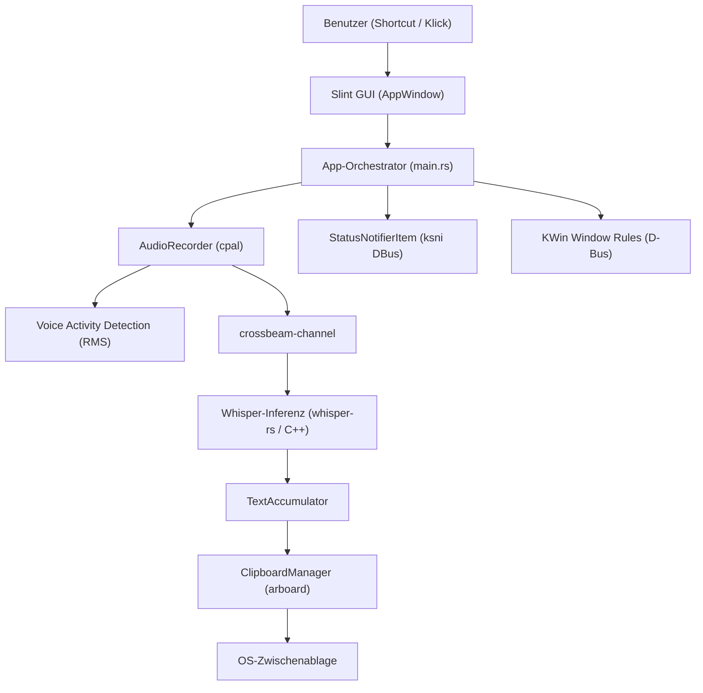
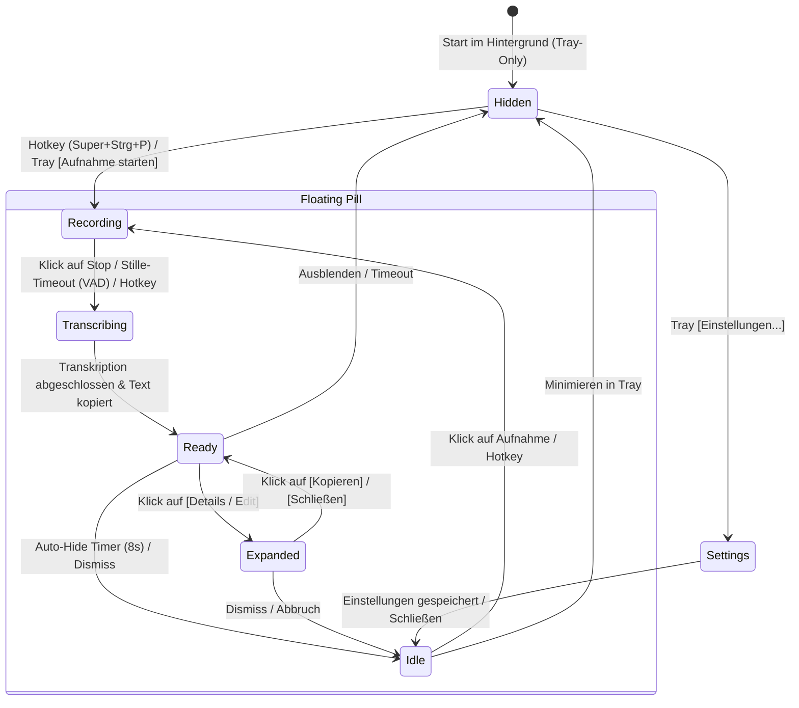
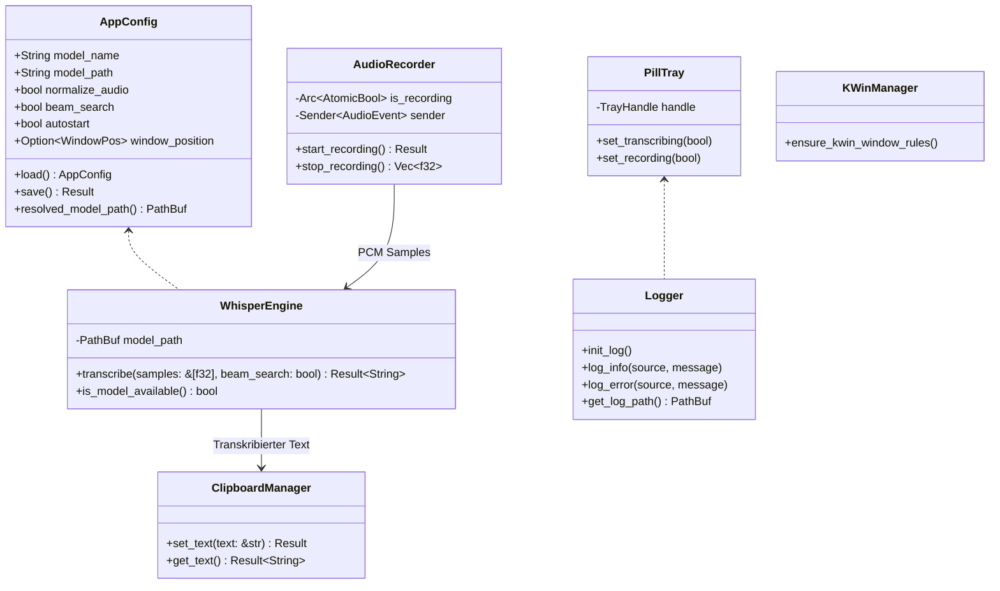
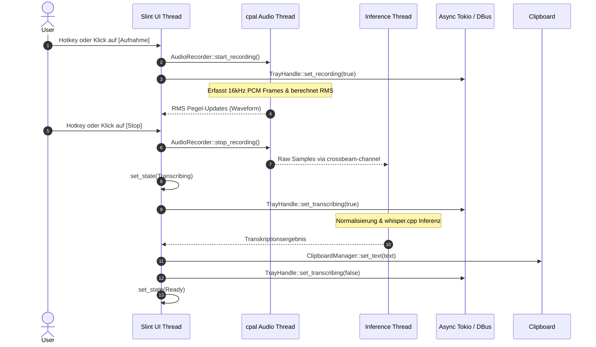

# Technische Architektur- und Entwicklerdokumentation: Whisper Pill (Rust & Slint)

Diese Dokumentation beschreibt die interne Software-Architektur, Modulstrukturen, Datenflüsse, Threading-Modelle und Build-Pipelines der nativen **Whisper Pill** Rust-Anwendung.

---

## 1. Systemübersicht & Design-Prinzipien

`Whisper Pill` ist ein schlankes, minimalistisches, schwebendes Desktop-Diktier-Utility (Pill-UI) für Linux und Windows als freie, quelloffene und 100 % lokale Alternative zu proprietären Lösungen wie Whisperbar.



### Kernprinzipien:
* **100 % Offline / Zero-Download:** Lokale Inferenz direkt auf der CPU mittels hardwarebeschleunigter GGML-Modelle (`whisper-rs` / C++ Inferenzkern). Keine externen Serververbindungen, keine Telemetrie, keine Cloud-Kosten.
* **Non-Blocking UI & Thread-Entkopplung:** Die GUI läuft im Slint-Event-Loop. Audio-Aufnahme und rechenintensive KI-Transkription erfolgen vollständig in separaten Hintergrund-Threads.
* **Wayland & X11 Native:** Native Integration unter KDE Plasma, GNOME und XFCE. Automatische KWin-Fensterregeln via D-Bus verhindern störende Taskleisten-Einträge und Fensterwechsler-Popups (`Alt+Tab`).
* **Minimaler Footprint:** Autark kompilierte Binärdatei ohne Interpreter oder Laufzeit-Overhead. Als Linux-AppImage umfasst die gesamte Anwendung lediglich ca. **13 MB**.

---

## 2. Zustandsautomat (Pill State Machine)

Die Benutzeroberfläche basiert auf Slint und steuert die visuelle Kapsel über definierte Zustände:



### Die Zustände im Detail:
1. **`Hidden` (0×0 px):** Die Pill ist unsichtbar. Die Anwendung läuft ressourcenschonend im System-Tray (SNI/AppIndicator).
2. **`Recording` (520×48 px):** Mikrofon aktiv. Zeigt pulsierenden roten Aufnahme-Indikator, dynamische Live-Audio-Pegelbalken und sekundenweisen Aufnahme-Timer.
3. **`Transcribing` (520×48 px):** KI-Inferenz aktiv. Visualisiert Ladeanimation (`Transkribiere...`), während das Tray-Icon auf pulsierende bernsteinfarbene Wellenform umschaltet.
4. **`Ready` (520×48 px):** Erfolgsmeldung (`In Zwischenablage kopiert!`). Der Text steht sofort via <kbd>Strg</kbd>+<kbd>V</kbd> zur Verfügung.
5. **`Expanded` (520×240 px):** Ausgeklappter Editor für Review, manuelle Korrekturen und Nachbearbeitung längerer Diktate.
6. **`Settings` (580×480 px):** Großzügiger Einstellungsdialog zur Auswahl des Whisper-Modells (Base vs. Small), Suchstrategie (Greedy vs. Beam Search), Mikrofon-Gain und Autostart.

---

## 3. Modul- und Komponentenarchitektur

Die Rust-Crate ist modular in Schichten unterteilt:



### Komponenten-Übersicht:
* **`audio::recorder`:** Kapselt die systemnahe Audio-Erfassung über `cpal`. Konvertiert beliebige Eingangsabtastraten und Kanalzahlen verlustfrei in 16 kHz Mono PCM (Whisper-Standard).
* **`audio::vad`:** Voice Activity Detection basierend auf Signal-Energie (RMS). Erkennt Sprechpausen und beendet die Aufnahme bei Wunsch automatisch nach konfigurierbarem Timeout.
* **`transcription::engine`:** Bindung an die hardwarenahe C++ `whisper.cpp`-Bibliothek über `whisper-rs`. Unterstützt FP16/AVX/FMA-Beschleunigung und Peak-Normalisierung.
* **`transcription::accumulator`:** Führt Teilergebnisse sequentieller Diktate mit intelligenter Leerzeichen- und Satzzeichentrennung zusammen.
* **`platform::tray`:** Implementierung der Freedesktop StatusNotifierItem-Spezifikation (SNI via `ksni`). Bietet dynamische Icon-Aktualisierung (`NewIcon`), Mouseover-Tooltips und Kontextmenü (Aufnahme, Einstellungen, Fehlerlog, Beenden).
* **`platform::kwin`:** Konfiguriert D-Bus-Fensterregeln für KWin/Wayland, um Taskleisten-Einträge und Fensterwechsler-Popups für das schwebende Fenster zu unterdrücken.
* **`platform::autostart`:** Verwaltet standardkonforme XDG-Desktop-Dateien unter `~/.config/autostart/`.
* **`platform::clipboard`:** Thread-sichere Zwischenablageverwaltung über `arboard` (Wayland/X11/Windows).
* **`logging`:** Zero-Dependency Fehlerprotokollierung in `$XDG_STATE_HOME/whisper_pill/error.log` mit UTC-Zeitstempeln.

---

## 4. Datenfluss & Threading-Modell

Um absolute Ruckelfreiheit der Benutzeroberfläche sicherzustellen, arbeitet Whisper Pill mit vier spezialisierten Ausführungskontexten:



---

## 5. Build-, Packaging- & AppImage-Pipeline

Whisper Pill lässt sich mit einem einzigen Shell-Skript vollständig in ein distributionsunabhängiges Linux-AppImage kompilieren:

```bash
./scripts/build_appimage.sh
```

### Der Build-Ablauf im Detail:
1. **Rust Release-Kompilierung:**  
   `cargo build --release` kompiliert alle Module mit `-O3` und Link-Time-Optimization (LTO). Der Inferenzkern `whisper.cpp` wird via CMake nativ in die Binärdatei gelinkt.
2. **Icon- & Metadaten-Generierung:**  
   Das Vektor-Icon `packaging/whisper-pill.svg` wird bei Bedarf automatisch in mehrfach skalierte PNGs gerastert.
3. **AppDir-Struktur:**  
   Erstellung der Freedesktop-Verzeichnisstruktur:
   - `AppDir/AppRun` (Starter-Skript mit dynamischen `LD_LIBRARY_PATH`- und Font-Pfadexporten)
   - `AppDir/whisper-pill.desktop`
   - `AppDir/usr/bin/whisper_pill`
   - `AppDir/usr/share/icons/...`
4. **SquashFS & AppImageKit Packaging:**  
   `appimagetool` generiert mit Zstandard-Kompression das finale Bundle `dist/Whisper_Pill-x86_64.AppImage` (Größe: ca. 13 MB).
