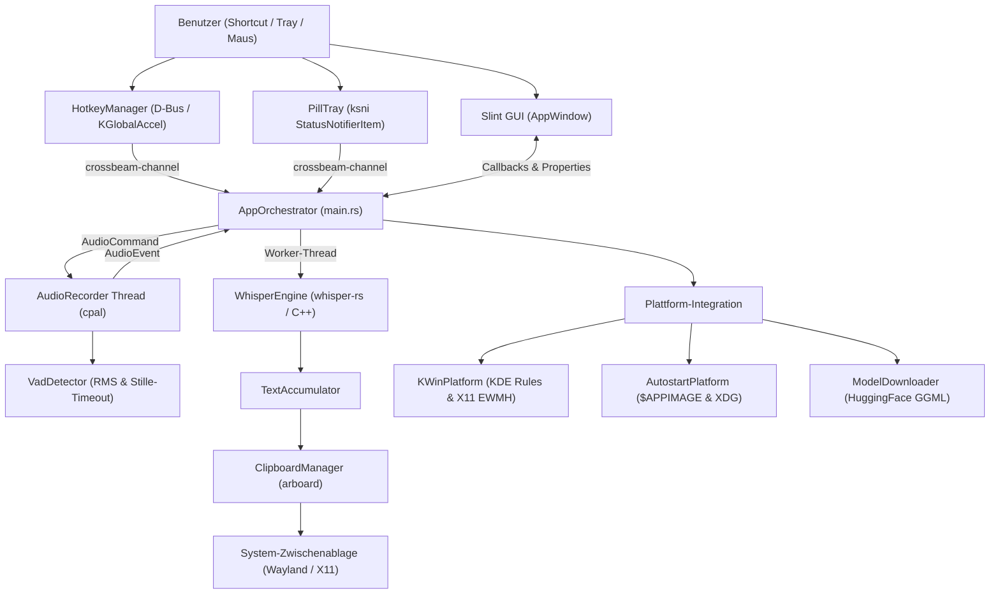
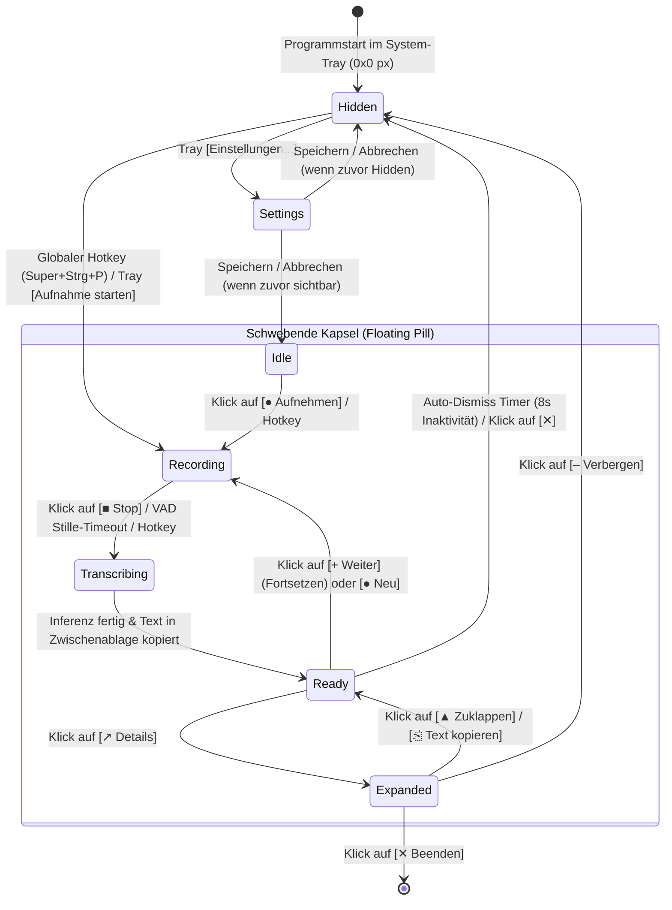
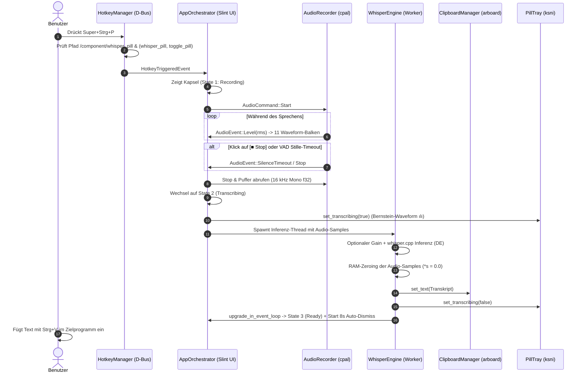

# Technische Architektur- und Entwicklerdokumentation: Whisper Pill (Rust, Slint & AppImage)

Diese Dokumentation beschreibt die interne Software-Architektur, Modulstrukturen, Zustandsautomaten, Threading-Modelle, Desktop-Integrationen (**KDE Plasma** und **XFCE**) sowie die **AppImage-Build-Pipeline** der nativen **Whisper Pill** Rust-Anwendung.

---

## 1. Systemübersicht & Architektur-Prinzipien

`Whisper Pill` ist ein schlankes, schwebendes Desktop-Diktier-Utility für Linux und Windows, das als 100 % lokale Open-Source-Alternative zu kommerziellen Lösungen konzipiert wurde. Die Produktionsanwendung ist vollständig in **Rust (Edition 2024)** mit dem deklarativen **Slint UI-Framework (`1.18`)** und **`whisper-rs` (`whisper.cpp`)** implementiert.



### Kernprinzipien der Rust-Architektur
* **100 % Lokale Offline-Inferenz:** Die Spracherkennung läuft ohne Server-Backend oder Cloud-Verbindung direkt im Adressraum der Anwendung über `whisper-rs` (`whisper.cpp`). Im regulären Diktierbetrieb findet keinerlei Netzwerkkommunikation statt.
* **Strikte Thread-Entkopplung (Non-Blocking UI):** Der Slint-Event-Loop im Hauptthread ist vollständig von der Echtzeit-Audioerfassung (`cpal`), der rechenintensiven KI-Transkription (`WhisperEngine`) und den asynchronen D-Bus-Diensten (`tokio` für `ksni` und `zbus`) entkoppelt.
* **Speichersicherheit & Datenschutz (RAM-Zeroing):** Der gesamte Anwendungscode kommt ohne `unsafe`-Blöcke aus. Aufgenommene Audiosamples werden unmittelbar nach der Transkription im Arbeitsspeicher mit Nullen (`0.0`) überschrieben (`AudioRecorder::flush_memory()` sowie im Inferenz-Worker).
* **Portables Einzeldatei-Deployment (AppImage):** Gebündelt als komprimiertes Linux-AppImage umfasst die gesamte Anwendung inklusive Slint-Renderer und C++-Whisper-Kern lediglich ca. **13 MB**.

---

## 2. Zustandsautomat (Pill State Machine)

Die visuelle Kapsel wird über einen klar definierten Zustandsautomaten gesteuert:



### Die 6 Laufzeitzustände im Detail

| Zustand | Fenstergröße | Technische Beschreibung |
| :--- | :--- | :--- |
| **`Hidden`** | Unsichtbar (Tray) | Kein sichtbares Fenster; minimaler Ressourcenverbrauch im Hintergrund. Reagiert auf D-Bus-Hotkeys und Tray-Menü-Ereignisse. |
| **`Idle` (`0`)** | `520 × 48 px` | Kompakte Bereitschaftskapsel (`🎙 Whisper Pill`) mit Start-Button `[● Aufnehmen]`. |
| **`Recording` (`1`)** | `520 × 48 px` | Mikrofon-Stream aktiv. Berechnet alle ~30 ms den RMS-Pegel, skaliert die 11 Wellenform-Balken (`bar0..bar10`) über eine Glockenkurve und aktualisiert den Monospace-Timer (`00:04`). |
| **`Transcribing` (`2`)** | `520 × 48 px` | Zeigt `⟳ Transkribiere Audiosignal...`, während das System-Tray-Icon (`PillTray`) live auf eine bernsteinfarbene Wellenform (`ılı`) umschaltet. |
| **`Ready` (`3`)** | `520 × 48 px` | Erfolgsmeldung (`✔ In Zwischenablage kopiert!`) mit Schnellaktionen (`[+ Weiter]`, `[● Neu]`, `[↗ Details]`, `✕`). Startet einen **8-Sekunden-Auto-Dismiss-Timer**, der die Pill ohne Interaktion automatisch ausblendet. |
| **`Expanded` (`4`)** | `520 × 240 px` | Ausgeklappter Review- und Text-Editor mit nativem `Flickable`-Container, dynamischer `content-height` und 6 px breiter Custom-Scrollbar (bedienbar per Mausrad, Tastatur und Drag-Daumen). Aktionsleiste mit `[▲ Zuklappen]`, `[– Verbergen]`, `[✕ Beenden]` und `[⎘ Text kopieren]`. |
| **`Settings`** | `580 × 480 px` | Integrierter Konfigurationsdialog für Autostart, KI-Sprachmodell (`base` vs. `small` inkl. Hintergrund-Download), Audio-Normalisierung (`Gain`) und Suchstrategie (`Greedy` vs. `Beam Search`). |

---

## 3. Modul- und Klassenarchitektur

```mermaid
classDiagram
    class AppConfig {
        +String model_name
        +String model_path
        +bool normalize_audio
        +bool beam_search
        +bool autostart
        +Option~i32~ window_x
        +Option~i32~ window_y
        +load() AppConfig
        +save() Result
        +resolved_model_path() PathBuf
        +is_model_installed(name: &str) bool
    }

    class AudioRecorder {
        +start_recording() Result
        +stop_recording() Vec~f32~
        +flush_memory()
        +downmix_to_mono(data: &[f32], channels: usize) Vec~f32~
        +resample_linear(input: &[f32], in_rate: u32, out_rate: u32) Vec~f32~
    }

    class VadDetector {
        +compute_rms(samples: &[f32]) f32
        +process_chunk(samples: &[f32], duration_secs: f32) bool
        +reset()
    }

    class WhisperEngine {
        -Mutex~PathBuf~ model_path
        -Mutex~Option~WhisperContext~~ context
        +new(model_path: PathBuf) WhisperEngine
        +set_model_path(new_path: PathBuf)
        +ensure_model_available() Result
        +load_model() Result
        +transcribe(samples: &[f32], lang: Option~&str~, beam: bool, norm: bool) Result~String~
    }

    class ModelDownloader {
        +model_cache_dir() PathBuf
        +model_download_url(model_name: &str) String
        +download_model_if_missing(model_name: &str) Result~PathBuf~
        +spawn_background_download(model_name: String, on_complete: FnOnce)
    }

    class HotkeyManager {
        +start_listener()
        +register_kde_shortcut()
        +is_whisper_pill_shortcut(component: &str, action: &str) bool
    }

    class KWinPlatform {
        +ensure_kwin_window_rules()
        +ensure_x11_window_properties()
    }

    class AutostartPlatform {
        +autostart_desktop_path() PathBuf
        +get_persistent_executable_path() Result~String~
        +is_autostart_enabled() bool
        +set_autostart(enabled: bool) Result
    }

    class PillTray {
        +spawn_tray(tx: Sender~TrayAction~) TrayHandle
        +create_tray_icon(size: i32, is_transcribing: bool) Icon
    }

    class ClipboardManager {
        +set_text(text: &str) Result
        +get_text() Result~String~
    }

    AppOrchestrator --> AppConfig
    AppOrchestrator --> AudioRecorder
    AppOrchestrator --> WhisperEngine
    AppOrchestrator --> ModelDownloader
    AppOrchestrator --> HotkeyManager
    AppOrchestrator --> KWinPlatform
    AppOrchestrator --> AutostartPlatform
    AppOrchestrator --> PillTray
    AppOrchestrator --> ClipboardManager
    AudioRecorder --> VadDetector
```



---

## 4. Multi-Threading & Sequenzfluss der Audio-zu-Clipboard-Pipeline

Damit die Slint-Oberfläche zu jedem Zeitpunkt mit 60 FPS auf Benutzereingaben reagiert, ist die Anwendung in fünf kooperierende Ausführungskontexte unterteilt:

1. **Main-Thread (Slint Event-Loop):** Rendert das `AppWindow`, verarbeitet UI-Callbacks und führt den 500-ms-Wartungstimer (Aufnahme-Uhrzeit, Fensterpositions-Persistenz, 8-Sekunden-Auto-Dismiss) aus. Updates aus Hintergrund-Threads erfolgen ausschließlich threadsicher über `slint::invoke_from_event_loop` bzw. `window_weak.upgrade_in_event_loop(...)`.
2. **Audio-Controller- & `cpal`-Stream-Thread (`whisper-audio-ctrl`):** Hält den plattformspezifischen Audio-Input-Stream (ALSA / PipeWire / PulseAudio), konvertiert Mehrkanal-Audio per Downmix auf Mono, führt ein lineares Resampling auf **16.000 Hz Float32** durch und prüft über `VadDetector` auf Sprechpausen.
3. **Audio-Event-Bridge-Thread (`whisper-audio-events`):** Empfängt `AudioEvent::Level(rms)` und `AudioEvent::SilenceTimeout` über `crossbeam-channel` und aktualisiert die 11 Wellenform-Balken im UI.
4. **Whisper-Inferenz-Worker-Thread (`whisper-transcribe-worker`):** Wird pro abgeschlossener Aufnahme gespawnt, führt optional die Peak-Normalisierung (`normalize_audio_samples`, Zielpegel `0.95`, max. `5.0x` Gain) sowie die `whisper.cpp`-Inferenz (Greedy oder 5-Wege Beam Search mit deutschem Initial-Prompt für präzise Interpunktion) aus, schreibt das Ergebnis in die Zwischenablage und überschreibt die Roh-Audiodaten im RAM sofort mit `0.0`.
5. **D-Bus Background-Threads (`whisper-dbus-hotkey` & `ksni`-Runtime):** Asynchrone Tokio-Tasks für das System-Tray-Icon und den Empfang globaler Tastenkombinationen.



---

## 5. Desktop-Integration: KDE Plasma (Wayland/X11) vs. XFCE (X11)

### 5.1 KDE Plasma 5 & 6 (Wayland und X11)
* **D-Bus Hotkey-Registrierung & strikte Signal-Isolierung (`HotkeyManager`):**
  * Beim Start registriert `register_kde_shortcut()` das Kürzel `Meta+Ctrl+P` (`Super+Strg+P`) via `gdbus` beim Dienst `org.kde.kglobalaccel` (`/kglobalaccel`) und persistiert es über `kwriteconfig6`/`kwriteconfig5` in `kglobalshortcutsrc`.
  * Da KDE `KGlobalAccel` das Signal `globalShortcutPressed` für verschiedene Desktop-Komponenten emittiert, verwendet `listen_dbus_signals()` eine doppelt abgesicherte Filterung:
    1. **D-Bus Match-Rule:** Eingegrenzt auf `path = "/component/whisper_pill"`, `interface = "org.kde.kglobalaccel.Component"`, `member = "globalShortcutPressed"`.
    2. **Payload-Deserialisierung (`is_whisper_pill_shortcut`):** Deserialisiert den Signal-Body `(String, String, i64)` und löst nur dann aus, wenn `component == "whisper_pill"` und `action == "toggle_pill"` exakt übereinstimmen. Dadurch lösen externe Tasten wie <kbd>F12</kbd> (Yakuake) oder <kbd>Super</kbd> (Anwendungsmenü) niemals fälschlich eine Aufnahme aus.
* **KWin-Fensterregeln & Z-Order-Harmonie (`KWinPlatform::ensure_kwin_window_rules`):**
  * Konfiguriert in `kwinrulesrc` automatisch eine Regel für `title = "Whisper Pill"` mit `skiptaskbar = true` (`skiptaskbarrule = 2`) und `skipswitcher = true` (`skipswitcherrule = 2`), gefolgt von einem Live-Reload via `qdbus org.kde.KWin /KWin reconfigure`.
  * **Bewusste Deaktivierung von `aboverule=2`:** `above` wird in KWin explizit auf `false` (`aboverule = 0`) gesetzt. Die normale Vordergrund-Platzierung erfolgt über Slints `always-on-top: true`, sodass System-Overlays und Dropdown-Terminals wie **Yakuake** nicht von der Kapsel überdeckt werden. Zusätzlich sorgt der **8-Sekunden-Auto-Dismiss-Timer** im `Ready`-Zustand dafür, dass die Kapsel nach erledigter Arbeit automatisch vom Bildschirm verschwindet.

### 5.2 XFCE Desktop & X11-Umgebungen
* **X11 EWMH-Fensterattribute (`KWinPlatform::ensure_x11_window_properties`):**
  * Sobald eine X11-Sitzung (`$DISPLAY`) erkannt wird, setzt die Anwendung beim Einblenden über `xprop` die EWMH-Atome `_NET_WM_STATE_SKIP_TASKBAR` und `_NET_WM_STATE_SKIP_PAGER`. Dadurch erscheint die rahmenlose Kapsel unter dem XFCE-Fenstermanager **Xfwm4** weder in der Fensterleiste des Panels noch im <kbd>Alt</kbd>+<kbd>Tab</kbd>-Umschalter.
* **System-Tray über StatusNotifierItem (`PillTray`):**
  * Nutzt das `ksni`-Crate (`org.kde.StatusNotifierItem` über D-Bus), welches vom modernen XFCE-Panel-Plugin (`xfce4-statusnotifier-plugin` / „Benachrichtigungsfläche“) nativ unterstützt wird. Das Icon wird zur Laufzeit prozedural als scharfes ARGB32-Pixelbild (`create_tray_icon`) gerendert und benötigt keine externen Icon-Theme-Pfade.
* **Audio & Zwischenablage unter XFCE:**
  * `cpal` verbindet sich transparent mit PipeWire bzw. PulseAudio/ALSA; `arboard` verwaltet die X11-Clipboard-Selections (`CLIPBOARD`) zuverlässig im Hintergrund.

---

## 6. AppImage-Architektur, Autostart & Build-Pipeline

### 6.1 Aufbau des portablen Linux-AppImages (`scripts/build_appimage.sh`)
Das Build-Skript erzeugt ein distributionsübergreifendes Einzeldatei-Bundle (`dist/Whisper_Pill-x86_64.AppImage`):
1. **Release-Kompilierung:** Führt `cargo build --release --manifest-path app/Cargo.toml` aus (statisch gelinkter Rust-Code + optimierter C++ `whisper.cpp`-Kern).
2. **AppDir-Assemblierung (`dist/AppDir/`):**
   * `usr/bin/whisper_pill`: Die kompilierte Release-Binärdatei.
   * `usr/share/applications/whisper-pill.desktop` & `whisper-pill.desktop`: Freedesktop-Metadaten.
   * `usr/share/icons/hicolor/...`: Hochauflösende SVG- und PNG-Icons (`64x64` bis `512x512`).
   * `AppRun`: Startskript, das `LD_LIBRARY_PATH` und `XDG_DATA_DIRS` relativ zum gemounteten AppDir exportiert und `whisper_pill "$@"` inklusive aller CLI-Flags startet.
3. **SquashFS-Paketierung:** `appimagetool` komprimiert das `AppDir` mit der AppImage-Laufzeitumgebung in eine einzige ausführbare Datei (~13 MB).

### 6.2 Persistente AppImage-Autostart-Auflösung (`AutostartPlatform`)
Wenn ein AppImage ausgeführt wird, mountet die AppImage-Runtime das Image temporär unter `/tmp/.mount_WhispeXXXXXX/`. Würde `std::env::current_exe()` für den Autostart-Eintrag (`~/.config/autostart/whisper-pill.desktop`) genutzt, zeigte der Pfad nach einem Neustart ins Leere.
* **Lösung in `get_persistent_executable_path()`:** Prüft vorrangig die von der AppImage-Laufzeit gesetzte Umgebungsvariable `$APPIMAGE`, validiert die Existenz der Zieldatei und trägt diesen dauerhaften Pfad in `Exec="..."` ein.
* **Selbstheilung beim Programmstart:** Bei jedem Start prüft `AppOrchestrator`, ob der in `~/.config/autostart/whisper-pill.desktop` hinterlegte `Exec=`-Pfad noch gültig ist, aktualisiert ihn bei Abweichung automatisch auf den aktuellen AppImage-Pfad und stellt die Ausführungsrechte (`0o755`) sowohl für die `.desktop`-Datei als auch für das AppImage sicher.

### 6.3 Automatisierter Slint-Screenshot-Generator (`--capture-screenshots`)
Zur Qualitätssicherung und Dokumentationspflege verfügt die Rust-Binärdatei über einen eingebauten Screenshot-Modus (`run_screenshot_capture` in `app/src/main.rs`):
* Aufruf: `cargo run --manifest-path app/Cargo.toml -- --capture-screenshots docs/assets` (oder direkt über das AppImage).
* Durchläuft zeitgesteuert alle 5 UI-Zustände (`Idle`, `Recording`, `Ready`, `Expanded`, `Settings`), greift den Framebuffer direkt über `slint::Window::take_snapshot()` ab und kodiert die RGBA8-Pixel über einen abhängigkeitsfreien Standardbibliotheks-PNG-Encoder (`save_rgba_as_png`) in `docs/assets/state_0_idle.png` bis `state_4_settings.png`.

---

## 7. Build-, Test- und Verifikationsbefehle

```bash
# 1. Statische Code- und Lint-Prüfung (0 Warnungen erzwungen)
cargo clippy --manifest-path app/Cargo.toml --all-targets -- -D warnings

# 2. Alle 42 Rust-Unit- und Integrationstests ausführen
cargo test --manifest-path app/Cargo.toml

# 3. Zero-Download & Offline-Sicherheitsprüfung ausführen
python3 .agent/skills/security-audit/scripts/check_downloads.py

# 4. UI-Screenshots direkt aus der Rust-App neu generieren
cargo run --manifest-path app/Cargo.toml -- --capture-screenshots docs/assets

# 5. Portables Release-AppImage bauen
./scripts/build_appimage.sh
```
