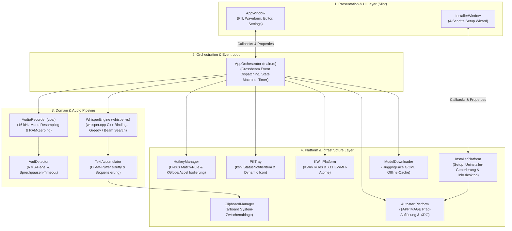
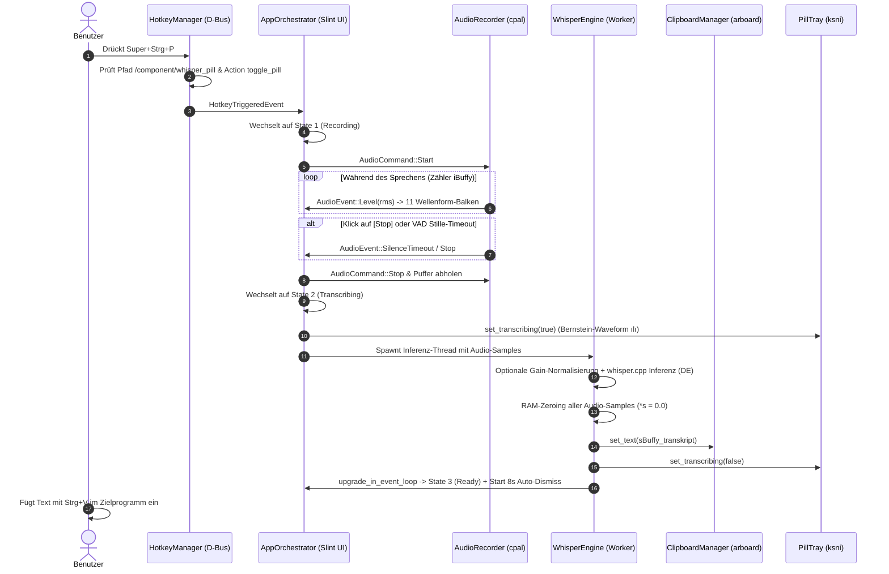
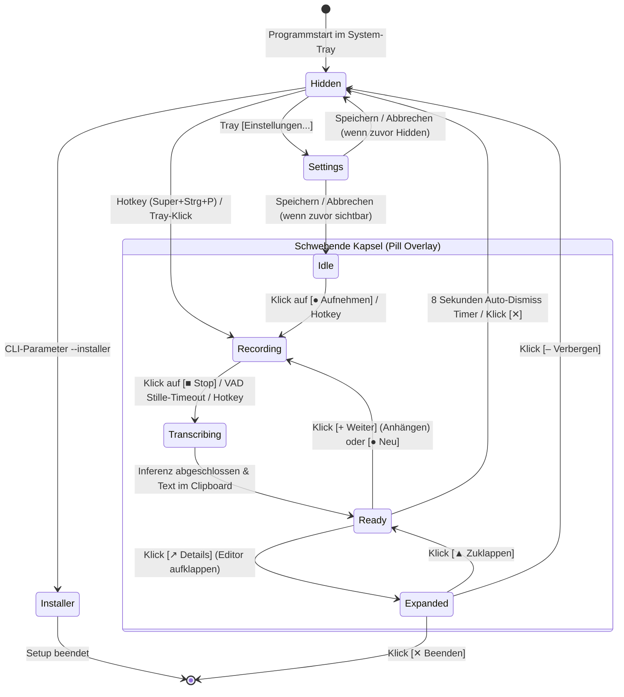
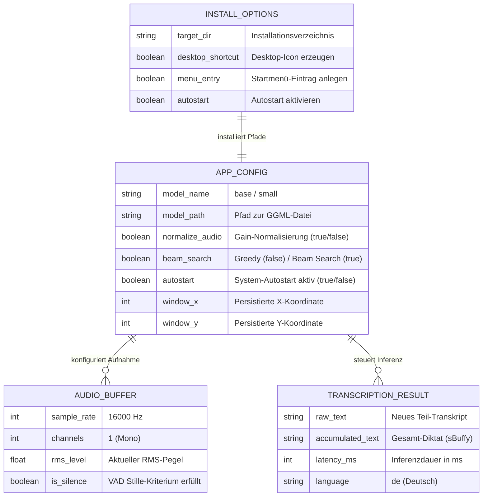

# Technische Architektur- und Entwicklerdokumentation: Whisper Pill (Rust, Slint & AppImage)

> **Vollständige technische Spezifikation, Architektur-Muster, Threading-Modelle, Desktop-Integrationen und Build-Pipelines der nativen Whisper Pill Anwendung.**

---

## 1. Systemübersicht & Schichtenarchitektur

`Whisper Pill` ist als 100 % lokales, modulares Desktop-Diktier-Utility konzipiert. Die Produktionsarchitektur basiert auf **Rust (Edition 2024)**, dem deklarativen GUI-Framework **Slint (`1.18`)**, nativer Audioerfassung über **`cpal`** und lokaler KI-Inferenz via **`whisper-rs` (`whisper.cpp`)**.

### Schichtenarchitektur (Layered Architecture)



---

## 2. Modul- und Klassendesign (UML Class Diagram)

```mermaid
classDiagram
    class AppConfig {
        +String model_name
        +String model_path
        +bool normalize_audio
        +bool beam_search
        +bool autostart
        +Option~i32~ window_x
        +Option~i32~ window_y
        +load() AppConfig
        +save() Result
        +resolved_model_path() PathBuf
        +is_model_installed(name: &str) bool
    }

    class InstallOptions {
        +PathBuf target_dir
        +bool desktop_shortcut
        +bool menu_entry
        +bool autostart
        +default_install_dir() PathBuf
    }

    class InstallerPlatform {
        +perform_installation(options: &InstallOptions, progress_cb) Result
        +generate_uninstall_scripts(target_dir: &Path) Result
        +create_desktop_shortcut(target_exe: &Path) Result
        +create_menu_entry(target_exe: &Path) Result
    }

    class AudioRecorder {
        +start_recording() Result
        +stop_recording() Vec~f32~
        +flush_memory()
        +downmix_to_mono(data: &[f32], channels: usize) Vec~f32~
        +resample_linear(input: &[f32], in_rate: u32, out_rate: u32) Vec~f32~
    }

    class VadDetector {
        +compute_rms(samples: &[f32]) f32
        +process_chunk(samples: &[f32], duration_secs: f32) bool
        +reset()
    }

    class WhisperEngine {
        -Mutex~PathBuf~ model_path
        -Mutex~Option~WhisperContext~~ context
        +new(model_path: PathBuf) WhisperEngine
        +set_model_path(new_path: PathBuf)
        +ensure_model_available() Result
        +load_model() Result
        +transcribe(samples: &[f32], lang: Option~&str~, beam: bool, norm: bool) Result~String~
    }

    class TextAccumulator {
        +append(existing: &str, new_part: &str) String
    }

    class HotkeyManager {
        +start_listener(tx: Sender~HotkeyEvent~)
        +register_kde_shortcut()
        +is_whisper_pill_shortcut(component: &str, action: &str) bool
    }

    class KWinPlatform {
        +ensure_kwin_window_rules()
        +ensure_x11_window_properties()
    }

    class AutostartPlatform {
        +autostart_desktop_path() PathBuf
        +get_persistent_executable_path() Result~String~
        +is_autostart_enabled() bool
        +set_autostart(enabled: bool) Result
    }

    class PillTray {
        +spawn_tray(tx: Sender~TrayAction~) TrayHandle
        +create_tray_icon(size: i32, is_transcribing: bool) Icon
    }

    class ClipboardManager {
        +set_text(text: &str) Result
        +get_text() Result~String~
    }

    class ModelDownloader {
        +model_cache_dir() PathBuf
        +model_download_url(model_name: &str) String
        +download_model_if_missing(model_name: &str) Result~PathBuf~
        +spawn_background_download(model_name: String, on_complete: FnOnce)
    }

    AppOrchestrator --> AppConfig
    AppOrchestrator --> AudioRecorder
    AppOrchestrator --> WhisperEngine
    AppOrchestrator --> TextAccumulator
    AppOrchestrator --> ModelDownloader
    AppOrchestrator --> HotkeyManager
    AppOrchestrator --> KWinPlatform
    AppOrchestrator --> AutostartPlatform
    AppOrchestrator --> PillTray
    AppOrchestrator --> ClipboardManager
    AudioRecorder --> VadDetector
    InstallerPlatform --> InstallOptions
```



---

## 3. Datenflüsse & Multi-Threading-Sequenz (Audio-to-Clipboard Pipeline)

Zur Erzielung von ruckelfreien 60 FPS in der Benutzeroberfläche und sofortiger Reaktionszeit ist die Laufzeitumgebung in fünf Ausführungskontexte aufgeteilt:

1. **Main-Thread (Slint UI Loop):** Event-Verarbeitung, 500-ms-Wartungstimer, Fensterpositions-Tracking und 8-Sekunden-Auto-Dismiss.
2. **Audio-Controller-Thread (`whisper-audio-ctrl`):** Verwaltet den `cpal`-Mikrofonstream, führt Mono-Downmix und 16-kHz-Resampling durch.
3. **Audio-Event-Bridge (`whisper-audio-events`):** Empfängt RMS-Pegel via `crossbeam-channel` und aktualisiert die 11 UI-Wellenformbalken.
4. **Whisper-Inferenz-Worker (`whisper-transcribe-worker`):** Führt optionale Gain-Normalisierung (Zielpegel `0.95`, max. `5.0x`), `whisper.cpp`-Inferenz und sofortiges RAM-Zeroing (`*s = 0.0`) durch.
5. **D-Bus Background-Tasks (`tokio`):** Asynchrone Runtime für System-Tray (`ksni`) und globale Shortcuts (`zbus`).



---

## 4. Vollständiger Zustandsautomat (Pill State Machine)



---

## 5. Daten- und Konfigurationsmodell (Schema-Modell)



---

## 6. Plattform-Integration & Systemschnittstellen

### 6.1 KDE Plasma 5 & 6 (Wayland & X11)
- **`HotkeyManager`:**
  - Registriert `Meta+Ctrl+P` über `org.kde.kglobalaccel` (`/kglobalaccel`).
  - **Strikte Match-Rule & Deserialisierung:** Match-Rule auf D-Bus-Objektpfad `/component/whisper_pill` beschränkt. Prüfung der Parameter `(component, action)`: Nur wenn `component == "whisper_pill"` und `action == "toggle_pill"` erfüllt sind, wird das Event weitergeleitet. Fremde Tastendrücke wie <kbd>F12</kbd> (Yakuake) oder <kbd>Super</kbd> (KRunner/Menü) werden zuverlässig verworfen.
- **KWin-Fensterregeln (`KWinPlatform`):**
  - Schreibt KWin-Regel für `title = "Whisper Pill"` mit `skiptaskbarrule = 2` und `skipswitcherrule = 2`.
  - Explizites `aboverule = 0`: Die Always-on-Top-Platzierung erfolgt rein deklarativ in Slint, sodass Yakuake oder Benachrichtigungen nicht verdeckt werden.

### 6.2 XFCE Desktop & X11-Umgebungen
- **EWMH-Fensterattribute:** Beim Einblenden setzt `KWinPlatform` via `xprop` die X11-Atome `_NET_WM_STATE_SKIP_TASKBAR` und `_NET_WM_STATE_SKIP_PAGER`.
- **StatusNotifierItem (`PillTray`):** Nutzt Freedesktop-SNI über Tokio/D-Bus. Das Icon wird zur Laufzeit als scharfes ARGB32-Pixelbild gerendert.

### 6.3 Windows & NSIS
- **Nativer Slint-Setup-Wizard (`InstallerWindow`):** 4-Schritte-Assistent für Windows und Linux zur autarken Installation ohne Drittanbieter-Tools.
- **MUI2-NSIS-Konfiguration (`packaging/windows/installer.nsi`):** Bereitstellung eines klassischen Win32-Setup-Installers mit Uninstaller und Registry-Einträgen.

---

## 7. Speicherhygiene & Zero-Download-Sicherheit

1. **RAM-Zeroing:** Nach der Inferenz überschreibt der Inferenz-Worker alle Audio-Samples mit `0.0`. `AudioRecorder::flush_memory()` leert die internen Puffer vollständig.
2. **Zero-Download-Garantie:** Im regulären Diktierbetrieb finden keinerlei Netzwerkverbindungen statt (`local_files_only = true`).
3. **Automatisierte Überprüfung:**
   ```bash
   python3 .agent/skills/security-audit/scripts/check_downloads.py .
   ```
   Validiert AST-Imports, CLI-Downloader, Injections und Secrets (0 Befunde erforderlich).

---

## 8. Verifikations- und Testbefehle

```bash
# 1. Alle Rust-Unit-Tests ausführen
cargo test --manifest-path app/Cargo.toml

# 2. Rust Clippy (0 Warnungen)
cargo clippy --manifest-path app/Cargo.toml --all-targets -- -D warnings

# 3. Python-Prototyp Tests ausführen
./prototype/.venv/bin/pytest tests/ -v --tb=short

# 4. Automatisierter Download- & Security-Scan
python3 .agent/skills/security-audit/scripts/check_downloads.py .

# 5. Linux-AppImage bauen
./scripts/build_appimage.sh
```
